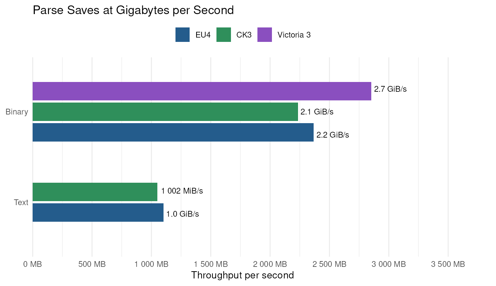

 [](https://docs.rs/jomini) [](https://crates.io/crates/jomini)

# Jomini

A low level, performance oriented parser for save and game files from [Paradox Development Studio](https://en.wikipedia.org/wiki/Paradox_Development_Studio) titles (eg: Europa Universalis (EU4), Hearts of Iron (HOI4), and Crusader Kings (CK3), Imperator, Stellaris, and Victoria).

For an in-depth look at the Paradox Clausewitz format and the pitfalls that come
trying to support all variations, consult [the write-up](https://pdx.tools/blog/a-tour-of-pds-clausewitz-syntax). In short, it's extremely difficult to write a robust and
fast parser that abstracts over the format difference between games as well as differences between game patches. Jomini hits the sweet spot between flexibility while still being ergonomic.

Jomini is the cornerstone of the [online EU4 save file
analyzer](https://pdx.tools). This library also powers the [Paradox Game
Converters](https://github.com/ParadoxGameConverters) and
[pdxu](https://github.com/crschnick/pdx_unlimiter).

## Features

- ✔ Versatile: Handle both plaintext and binary encoded data
- ✔ Fast: Parse data at over 1 GB/s
- ✔ Small: Compile with zero dependencies
- ✔ Safe: Extensively fuzzed against potential malicious input
- ✔ Ergonomic: Use [serde](https://serde.rs/derive.html)-like macros to have parsing logic automatically implemented
- ✔ Embeddable: Cross platform native apps, statically compiled services, or in the browser via [Wasm](https://webassembly.org/)

## Quick Start

Deserialize a Windows-1252 text snippet into a Rust struct. Clausewitz
files can repeat the same key. Here, `#[jomini(duplicated)]` collects
each `core` entry into `cores`.

```rust
use jomini::{JominiDeserialize, text::de::from_windows1252_slice};

#[derive(JominiDeserialize)]
struct Country {
    #[jomini(alias = "core", duplicated)]
    cores: Vec<String>,
}

let country: Country = from_windows1252_slice(b"core=HAB core=FRA")?;
assert_eq!(country.cores, ["HAB", "FRA"]);
```

A brace-delimited list also maps to a `Vec`. Here, the values all come
from a single `discovered_by` entry.

```rust
use jomini::{JominiDeserialize, text::de::from_windows1252_slice};

#[derive(JominiDeserialize)]
struct Province {
    discovered_by: Vec<String>,
}

let province: Province = from_windows1252_slice(b"discovered_by = { western eastern }")?;
assert_eq!(province.discovered_by, ["western", "eastern"]);
```

See [choosing a text deserializer](crates/jomini/src/text/mod.rs) for the
trade-offs and compatibility rules.

## Working with Save Files

### Saves without an envelope

For EU4 and HoI4, check the header for the payload format (for example,
`EU4txt` or `EU4bin`) and strip it. Use the game's encoding for text. For
binary token resolution, see [Binary Deserialization](#binary-deserialization).
A date can be a string in text and an integer in binary.

### Saves with an envelope

For EU5, Victoria 3, CK3, and Imperator saves on disk, use
[`JominiFile::from_file`](https://docs.rs/jomini/latest/jomini/envelope/struct.JominiFile.html#method.from_file). The [`envelope`](https://docs.rs/jomini/latest/jomini/envelope/index.html) module
describes the format and ZIP support.

With `envelope` and `serde`, read the in-game date from a minimal Imperator save.

```rust
use jomini::{common::Date, envelope::{JominiFile, SaveMetadataKind}};
use serde::Deserialize;

#[derive(Deserialize)]
struct Metadata {
    date: Date,
}

let file = JominiFile::from_slice(b"SAV0100c18f0de80000000e\ndate=450.10.1\n")?;
let SaveMetadataKind::Text(mut metadata) = file.meta()? else {
    return Err("expected text metadata".into());
};
let metadata: Metadata = metadata.deserializer().deserialize()?;
assert_eq!(metadata.date, Date::from_ymd(450, 10, 1));
```

## Reading Game and Mod Files

Use the [`text::syntax`](https://docs.rs/jomini/latest/jomini/text/syntax/index.html) module
when you need a lossless tree for diagnostics, recovery, or editing. With `syntax` and `serde` enabled,
you can deserialize game syntax such as bracketed expressions into a model.

```rust
use jomini::{Utf8Encoding, text::syntax::parse};
use serde::Deserialize;

#[derive(Deserialize)]
struct Portrait {
    picture: String,
}

let portrait: Portrait = parse(b"picture = [GetName]").deserialize(Utf8Encoding::new())?;
assert_eq!(portrait.picture, "[GetName]");
```

## Binary Deserialization

Deserializing data encoded in the binary format is done in a similar fashion but with a couple extra steps for the caller to supply:

- How text should be decoded (typically Windows-1252 or UTF-8)
- How rational (floating point) numbers are decoded
- How tokens, which are 16 bit integers that uniquely identify strings, are resolved

Implementors be warned, not only does each Paradox game have a different binary format, but the binary format can vary between patches!

Below is an example that defines a sample binary format and uses a hashmap token lookup.

```rust
use jomini::{Encoding, JominiDeserialize, Windows1252Encoding, binary::BinaryFlavor};
use std::{borrow::Cow, collections::HashMap};

#[derive(JominiDeserialize, PartialEq, Debug)]
struct MyStruct {
    field1: String,
}

#[derive(Debug, Default)]
pub struct BinaryTestFlavor;

impl BinaryFlavor for BinaryTestFlavor {
    fn visit_f32(&self, data: [u8; 4]) -> f32 {
        f32::from_le_bytes(data)
    }

    fn visit_f64(&self, data: [u8; 8]) -> f64 {
        f64::from_le_bytes(data)
    }
}

impl Encoding for BinaryTestFlavor {
    fn decode<'a>(&self, data: &'a [u8]) -> Cow<'a, str> {
        Windows1252Encoding::decode(data)
    }
}

let data = [ 0x82, 0x2d, 0x01, 0x00, 0x0f, 0x00, 0x03, 0x00, 0x45, 0x4e, 0x47 ];

let mut map = HashMap::new();
map.insert(0x2d82, "field1");

let actual: MyStruct = BinaryTestFlavor.deserialize_slice(&data[..], &map)?;
assert_eq!(actual, MyStruct { field1: "ENG".to_string() });
```

When done correctly, one can use the same structure to represent both the plaintext and binary data
without any duplication.

One can configure the behavior when a token is unknown (ie: fail immediately or try to continue).

### Direct identifier deserialization with `token` attribute

There may be some performance loss during binary deserialization as
tokens are resolved to strings via a `TokenResolver` and then matched against the
string representations of a struct's fields.

We can fix this issue by directly encoding the expected token value into the struct:

```rust
#[derive(JominiDeserialize, PartialEq, Debug)]
struct MyStruct {
    #[jomini(token = 0x2d82)]
    field1: String,
}

// Empty token to string resolver
let map = HashMap::<u16, String>::new();

let actual: MyStruct = BinaryDeserializer::builder_flavor(BinaryTestFlavor)
    .deserialize_slice(&data[..], &map)?;
assert_eq!(actual, MyStruct { field1: "ENG".to_string() });
```

Couple notes:

- This does not obviate need for the token to string resolver as tokens may be used as values.
- If the `token` attribute is specified on one field on a struct, it must be specified on all fields of that struct.

## Low-level Text APIs

[`text::TokenReader`](https://docs.rs/jomini/latest/jomini/text/struct.TokenReader.html) streams tokens. Legacy [`TextTape`](https://docs.rs/jomini/latest/jomini/struct.TextTape.html) readers iterate
over a parsed tape or convert it to JSON with the `json` feature.
For lossless tree access, use [`text::syntax`](https://docs.rs/jomini/latest/jomini/text/syntax/index.html).

## Write API

There are two targeted use cases for the write API. One is when a text tape is on hand.
This is useful when one needs to reformat a document (note that comments are not
preserved):

```rust
use jomini::{TextTape, TextWriterBuilder};

let tape = TextTape::from_slice(b"hello   = world")?;
let mut out: Vec<u8> = Vec::new();
let mut writer = TextWriterBuilder::new().from_writer(&mut out);
writer.write_tape(&tape)?;
assert_eq!(&out, b"hello=world");
```

The writer normalizes any formatting issues. The writer is not able to
losslessly write all parsed documents, but these are limited to truly
esoteric situations and hope to be resolved in future releases.

The other use case is geared more towards incremental writing that can be
found in melters or those crafting documents by hand. These use cases need to
manually drive the writer:

```rust
use jomini::TextWriterBuilder;
let mut out: Vec<u8> = Vec::new();
let mut writer = TextWriterBuilder::new().from_writer(&mut out);
writer.write_unquoted(b"hello")?;
writer.write_unquoted(b"world")?;
writer.write_unquoted(b"foo")?;
writer.write_unquoted(b"bar")?;
assert_eq!(&out, b"hello=world\nfoo=bar");
```

## Unsupported Syntax

Due to the nature of Clausewitz being closed source, this library can never guarantee compatibility with Clausewitz. There is no specification of what valid input looks like, and we only have examples that have been [collected in the wild](https://pdx.tools/blog/a-tour-of-pds-clausewitz-syntax). From what we do know, Clausewitz is recklessly flexible: allowing each game object to potentially define its own unique syntax.

We can only do our best and add support for new syntax as it is encountered.

## Benchmarks

Wall-clock benchmarks are run with the following command:

```bash
cargo bench --manifest-path bench/Cargo.toml --bench jomini-bench-criterion
```

The checked-in analysis data can be graphed with the R script found in the assets directory.

To overwrite `assets/jomini-benchmarks.csv` with fresh Criterion CSV output, run:

```bash
find bench/target/criterion -path "*/new/raw.csv" -print0 | xargs -0 xsv cat rows > assets/jomini-benchmarks.csv
```


